Weather data in Malå Sami reindeer herding district
================
2022-07-27

Here we explore two sources of weather data in the Malå Sami reindeer
herding district in Northern Sweden. The aim is to choose one of the
them to be used for inferring changes in reindeer habitat selection. The
first source comes from an interpolated map of SMHI, based on weather
station data, and includes spatial variation within the district, but
only one value per day (min temperature, max temperature, min wind
speed, max wind speed, accumulated precipitation). The second source
comes from a single weather station in Malå-Brannan. It includes
within-day variation in temperature, wind speed and direction, and
precipitation, but no spatial variation within the district.

``` r
# Load packages
if(!require(install.load)) install.packages("install.load"); library(install.load)

install.load::install_load("knitr", "rprojroot")

# Print options for this document
options(width = 165)
opts_knit$set(root.dir = rprojroot::find_rstudio_root_file()) # root project folder
opts_chunk$set(error = F, message = F, warning = F, cache = F, echo = T, results = T)
```

``` r
# packages
library(dplyr)
library(ggplot2)
```

# Temperature

``` r
# load weather data in spac
smhi_df <- readRDS("data/weather/smhi_df.RDS")
smhi_df
```

    ## # A tibble: 1,591,376 x 12
    ##    day           id meantemp mintemp maxtemp meanws minws maxws    wd precip snowDepth sunDuration
    ##    <date>     <int>    <dbl>   <dbl>   <dbl>  <dbl> <dbl> <dbl> <int>  <dbl>     <int>       <dbl>
    ##  1 2008-01-01  2527     -3.2    -4.5    -2.2    2.5   0.8   4      20    0          16         0  
    ##  2 2008-01-01  2528     -2.7    -4.6    -1.7    2.5   0.9   4      30    0          16         0  
    ##  3 2008-01-01  2555     -4.3    -5.6    -3.6    2.7   1.2   4      20    0          26         0  
    ##  4 2008-01-01  2556     -3.4    -4.5    -2.7    2.5   0.9   4.2    20    0          26         0.1
    ##  5 2008-01-01  2557     -3.6    -4.9    -2.7    2.6   1.3   4.2    20    0.1        23         0  
    ##  6 2008-01-01  2558     -3.1    -4.4    -2.4    2.3   0.8   3.8    20    0          16         0  
    ##  7 2008-01-01  2559     -2.9    -4.6    -1.9    2.4   1     3.8    30    0           8         0  
    ##  8 2008-01-01  2560     -2.2    -3.7    -1.2    3.4   2.3   4.6    50    0           1         0  
    ##  9 2008-01-01  2582     -6.4    -8.8    -4.6    2.2   0.4   3     360    0.8        32         2.1
    ## 10 2008-01-01  2583     -5.7    -7.4    -4.4    2.2   0.7   3.1    10    0.6        31         1.8
    ## # ... with 1,591,366 more rows

``` r
# summarize variation in space
summ_space_day <- smhi_df %>%
     dplyr::group_by(day) %>%
     dplyr::summarize(mintemp_min = min(mintemp, na.rm = T),
                      mintemp_max = max(mintemp, na.rm = T),
                      mintemp_avg = mean(mintemp, na.rm = T),
                      mintemp_sd = sd(mintemp, na.rm = T),
                      mintemp_range = range(mintemp, na.rm = T),
                      maxtemp_min = min(maxtemp, na.rm = T),
                      maxtemp_max = max(maxtemp, na.rm = T),
                      maxtemp_avg = mean(maxtemp, na.rm = T),
                      maxtemp_sd = sd(maxtemp, na.rm = T),
                      maxtemp_range = range(maxtemp, na.rm = T),
                      rangetemp = range(maxtemp - mintemp, na.rm = T)) %>% 
  dplyr::mutate(year = lubridate::year(day),
                yday = lubridate::yday(day)) 
summ_space_day
```

    ## # A tibble: 6,126 x 14
    ## # Groups:   day [3,063]
    ##    day        mintemp_min mintemp_max mintemp_avg mintemp_sd mintemp_range maxtemp_min maxtemp_max maxtemp_avg maxtemp_sd maxtemp_range rangetemp  year  yday
    ##    <date>           <dbl>       <dbl>       <dbl>      <dbl>         <dbl>       <dbl>       <dbl>       <dbl>      <dbl>         <dbl>     <dbl> <dbl> <dbl>
    ##  1 2008-01-01       -15.7        -3.6       -9.24      4.01          -15.7        -6.8        -1.2       -4.77      1.68           -6.8       1.7  2008     1
    ##  2 2008-01-01       -15.7        -3.6       -9.24      4.01           -3.6        -6.8        -1.2       -4.77      1.68           -1.2       9.3  2008     1
    ##  3 2008-01-02        -6.6        -3         -5.22      0.981          -6.6        -3.9        -0.4       -2.71      0.900          -3.9       1.5  2008     2
    ##  4 2008-01-02        -6.6        -3         -5.22      0.981          -3          -3.9        -0.4       -2.71      0.900          -0.4       4.1  2008     2
    ##  5 2008-01-03       -12.4        -5.9       -8.56      1.57          -12.4        -5.4        -3.1       -4.53      0.571          -5.4       1.8  2008     3
    ##  6 2008-01-03       -12.4        -5.9       -8.56      1.57           -5.9        -5.4        -3.1       -4.53      0.571          -3.1       8.6  2008     3
    ##  7 2008-01-04       -12.9        -7         -9.46      1.47          -12.9        -7          -3.9       -5.84      0.747          -7         1.7  2008     4
    ##  8 2008-01-04       -12.9        -7         -9.46      1.47           -7          -7          -3.9       -5.84      0.747          -3.9       7.7  2008     4
    ##  9 2008-01-05       -15.9        -5.9      -10.7       2.00          -15.9        -9.1        -3.9       -7.15      1.11           -9.1       1.5  2008     5
    ## 10 2008-01-05       -15.9        -5.9      -10.7       2.00           -5.9        -9.1        -3.9       -7.15      1.11           -3.9       8.2  2008     5
    ## # ... with 6,116 more rows

``` r
summ_space_day_persite <- smhi_df %>%
  dplyr::group_by(day, id) %>%
  dplyr::summarize(mintemp_min = min(mintemp, na.rm = T),
                   mintemp_max = max(mintemp, na.rm = T),
                   mintemp_avg = mean(mintemp, na.rm = T),
                   mintemp_sd = sd(mintemp, na.rm = T),
                   mintemp_range = range(mintemp, na.rm = T),
                   maxtemp_min = min(maxtemp, na.rm = T),
                   maxtemp_max = max(maxtemp, na.rm = T),
                   maxtemp_avg = mean(maxtemp, na.rm = T),
                   maxtemp_sd = sd(maxtemp, na.rm = T),
                   maxtemp_range = range(maxtemp, na.rm = T),
                   rangetemp = range(maxtemp - mintemp, na.rm = T)) %>% 
  dplyr::mutate(year = lubridate::year(day),
                yday = lubridate::yday(day)) 
summ_space_day_persite
```

    ## # A tibble: 3,182,752 x 15
    ## # Groups:   day, id [1,591,376]
    ##    day           id mintemp_min mintemp_max mintemp_avg mintemp_sd mintemp_range maxtemp_min maxtemp_max maxtemp_avg maxtemp_sd maxtemp_range rangetemp  year  yday
    ##    <date>     <int>       <dbl>       <dbl>       <dbl>      <dbl>         <dbl>       <dbl>       <dbl>       <dbl>      <dbl>         <dbl>     <dbl> <dbl> <dbl>
    ##  1 2008-01-01  2527        -4.5        -4.5        -4.5         NA          -4.5        -2.2        -2.2        -2.2         NA          -2.2       2.3  2008     1
    ##  2 2008-01-01  2527        -4.5        -4.5        -4.5         NA          -4.5        -2.2        -2.2        -2.2         NA          -2.2       2.3  2008     1
    ##  3 2008-01-01  2528        -4.6        -4.6        -4.6         NA          -4.6        -1.7        -1.7        -1.7         NA          -1.7       2.9  2008     1
    ##  4 2008-01-01  2528        -4.6        -4.6        -4.6         NA          -4.6        -1.7        -1.7        -1.7         NA          -1.7       2.9  2008     1
    ##  5 2008-01-01  2555        -5.6        -5.6        -5.6         NA          -5.6        -3.6        -3.6        -3.6         NA          -3.6       2    2008     1
    ##  6 2008-01-01  2555        -5.6        -5.6        -5.6         NA          -5.6        -3.6        -3.6        -3.6         NA          -3.6       2    2008     1
    ##  7 2008-01-01  2556        -4.5        -4.5        -4.5         NA          -4.5        -2.7        -2.7        -2.7         NA          -2.7       1.8  2008     1
    ##  8 2008-01-01  2556        -4.5        -4.5        -4.5         NA          -4.5        -2.7        -2.7        -2.7         NA          -2.7       1.8  2008     1
    ##  9 2008-01-01  2557        -4.9        -4.9        -4.9         NA          -4.9        -2.7        -2.7        -2.7         NA          -2.7       2.2  2008     1
    ## 10 2008-01-01  2557        -4.9        -4.9        -4.9         NA          -4.9        -2.7        -2.7        -2.7         NA          -2.7       2.2  2008     1
    ## # ... with 3,182,742 more rows

``` r
# load weather data for one location, with within-day variation
temp_day <- readr::read_csv2("data/weather/temperature_smhi_mala_brannan.csv", skip = 9) %>% 
  dplyr::select(day = Datum, time = 2, temperature = 3) %>% 
  dplyr::mutate(temperature = as.numeric(temperature),
                timestamp = lubridate::ymd_hms(paste(as.character(day), as.character(time))),
                temp_cat = ifelse(temperature <= 0, "negative", "positive"))
temp_day
```

    ## # A tibble: 215,840 x 5
    ##    day        time   temperature timestamp           temp_cat
    ##    <date>     <time>       <dbl> <dttm>              <chr>   
    ##  1 1995-12-15 00:22          0.5 1995-12-15 00:22:00 positive
    ##  2 1995-12-15 01:21          1.2 1995-12-15 01:21:00 positive
    ##  3 1995-12-15 02:22          1.1 1995-12-15 02:22:00 positive
    ##  4 1995-12-15 03:21          1.2 1995-12-15 03:21:00 positive
    ##  5 1995-12-15 04:21          2.1 1995-12-15 04:21:00 positive
    ##  6 1995-12-15 05:21          2.4 1995-12-15 05:21:00 positive
    ##  7 1995-12-15 06:21          2   1995-12-15 06:21:00 positive
    ##  8 1995-12-15 07:21          1.5 1995-12-15 07:21:00 positive
    ##  9 1995-12-15 08:18          2.2 1995-12-15 08:18:00 positive
    ## 10 1995-12-15 10:00          2.4 1995-12-15 10:00:00 positive
    ## # ... with 215,830 more rows

``` r
# summarize variation within a day
summ_within_day <- temp_day %>%
  dplyr::group_by(day) %>%
  dplyr::summarize(temp_min = min(temperature, na.rm = T),
                   temp_max = max(temperature, na.rm = T),
                   temp_avg = mean(temperature, na.rm = T),
                   temp_sd = sd(temperature, na.rm = T),
                   temp_range = range(temperature, na.rm = T)) %>% 
  dplyr::mutate(year = lubridate::year(day),
                yday = lubridate::yday(day)) %>% 
  dplyr::filter(year > 2007 & year < 2021)
summ_within_day
```

    ## # A tibble: 9,282 x 8
    ## # Groups:   day [4,641]
    ##    day        temp_min temp_max temp_avg temp_sd temp_range  year  yday
    ##    <date>        <dbl>    <dbl>    <dbl>   <dbl>      <dbl> <dbl> <dbl>
    ##  1 2008-01-01    -12.5     -6.1    -9.18   2.01       -12.5  2008     1
    ##  2 2008-01-01    -12.5     -6.1    -9.18   2.01        -6.1  2008     1
    ##  3 2008-01-02     -6       -3.6    -4.33   0.801       -6    2008     2
    ##  4 2008-01-02     -6       -3.6    -4.33   0.801       -3.6  2008     2
    ##  5 2008-01-03     -9.9     -4.4    -8.15   1.66        -9.9  2008     3
    ##  6 2008-01-03     -9.9     -4.4    -8.15   1.66        -4.4  2008     3
    ##  7 2008-01-04     -7.9     -6.1    -6.88   0.617       -7.9  2008     4
    ##  8 2008-01-04     -7.9     -6.1    -6.88   0.617       -6.1  2008     4
    ##  9 2008-01-05     -8.9     -6.7    -7.82   0.674       -8.9  2008     5
    ## 10 2008-01-05     -8.9     -6.7    -7.82   0.674       -6.7  2008     5
    ## # ... with 9,272 more rows

``` r
# plot

# range minimum temp
summ_space_day %>% 
  ggplot(aes(yday, abs(mintemp_range))) +
  geom_vline(xintercept = 30*4 + 5, linetype = 2, col = 2) + # May 5
  geom_vline(xintercept = 30*11 - 15, linetype = 2, col = 2) + # Nov 15
  geom_point() +
  geom_smooth() +
  facet_wrap(~year) +
  ylim(0, 30) +
  labs(x = "Day of the year",
       y = "Range of minimum temperature in space")
```

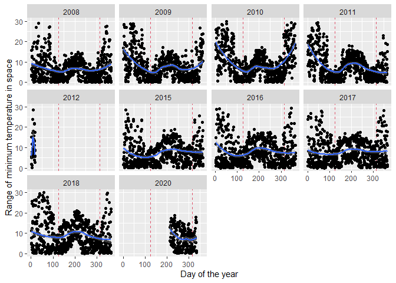<!-- -->

``` r
# range maximum temp
summ_space_day %>% 
  ggplot(aes(yday, abs(maxtemp_range))) +
  geom_vline(xintercept = 30*4 + 5, linetype = 2, col = 2) + # May 5
  geom_vline(xintercept = 30*11 - 15, linetype = 2, col = 2) + # Nov 15
  geom_point() +
  geom_smooth() +
  facet_wrap(~year) +
  ylim(0, 30) +
  labs(x = "Day of the year",
       y = "Range of maximum temperature in space")
```

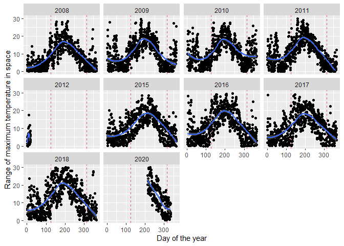<!-- -->

``` r
# range daily temp
summ_space_day %>% 
  ggplot(aes(yday, abs(rangetemp))) +
  geom_vline(xintercept = 30*4 + 5, linetype = 2, col = 2) + # May 5
  geom_vline(xintercept = 30*11 - 15, linetype = 2, col = 2) + # Nov 15
  geom_point() +
  geom_smooth() +
  facet_wrap(~year) +
  ylim(0, 30) +
  labs(x = "Day of the year",
       y = "Range of daily temperatures in space")
```

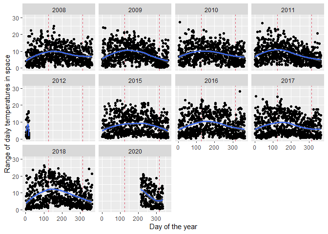<!-- -->

``` r
# range temp within a day
summ_within_day %>% 
  ggplot(aes(yday, abs(temp_range))) +
  geom_vline(xintercept = 30*4 + 5, linetype = 2, col = 2) + # May 5
  geom_vline(xintercept = 30*11 - 15, linetype = 2, col = 2) + # Nov 15
  geom_point() +
  geom_smooth() +
  facet_wrap(~year) +
  ylim(0, 30) +
  labs(x = "Day of the year",
       y = "Range of temperatures within a day in a single place")
```

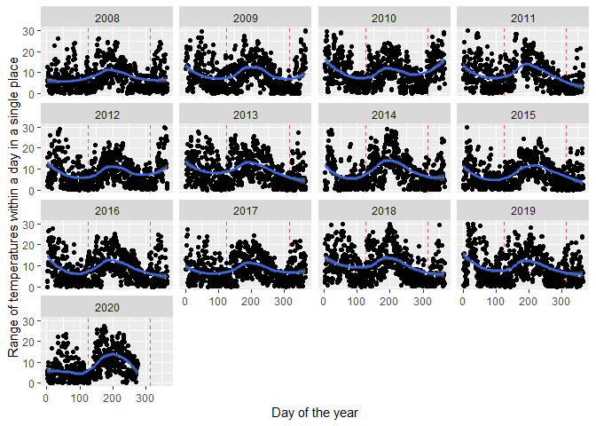<!-- -->

``` r
# sd minimum temp
summ_space_day %>% 
  dplyr::mutate(year = lubridate::year(day),
                yday = lubridate::yday(day)) %>% 
  ggplot(aes(yday, abs(mintemp_sd))) +
  geom_vline(xintercept = 30*4 + 5, linetype = 2, col = 2) + # May 5
  geom_vline(xintercept = 30*11 - 15, linetype = 2, col = 2) + # Nov 15
  geom_point() +
  geom_smooth() +
  facet_wrap(~year) +
  labs(x = "Day of the year",
       y = "SD of minimum temperature in space")
```

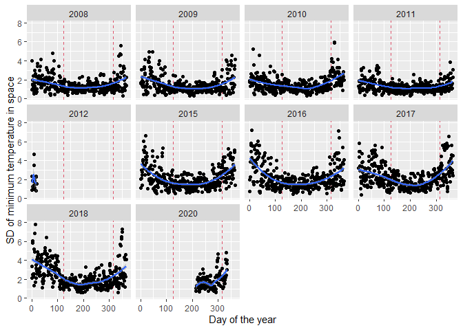<!-- -->

``` r
# sd maximum temp
summ_space_day %>% 
  dplyr::mutate(year = lubridate::year(day),
                yday = lubridate::yday(day)) %>% 
  ggplot(aes(yday, abs(maxtemp_sd))) +
  geom_vline(xintercept = 30*4 + 5, linetype = 2, col = 2) + # May 5
  geom_vline(xintercept = 30*11 - 15, linetype = 2, col = 2) + # Nov 15
  geom_point() +
  geom_smooth() +
  facet_wrap(~year) +
  labs(x = "Day of the year",
       y = "SD of maximum temperature in space")
```

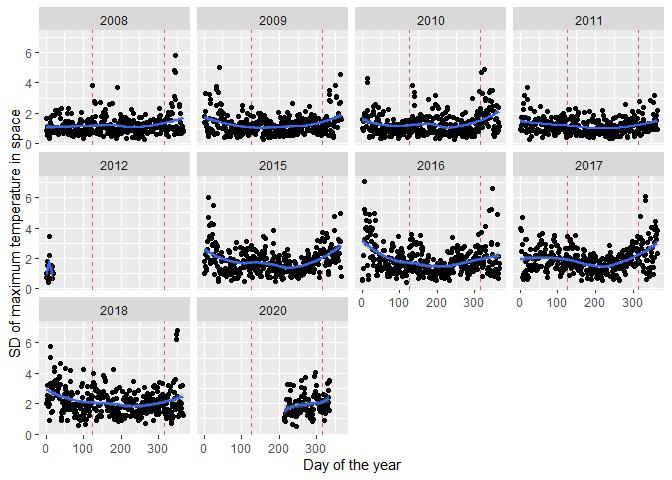<!-- -->

``` r
# SD temp within a day
summ_within_day %>% 
  ggplot(aes(yday, abs(temp_sd))) +
  geom_vline(xintercept = 30*4 + 5, linetype = 2, col = 2) + # May 5
  geom_vline(xintercept = 30*11 - 15, linetype = 2, col = 2) + # Nov 15
  geom_point() +
  geom_smooth() +
  facet_wrap(~year) +
  labs(x = "Day of the year",
       y = "SD of temperatures within a day in a single place")
```

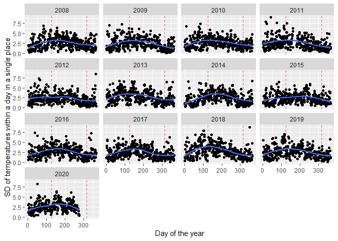<!-- -->

Wind speed and direction

``` r
# summarize variation in space
summ_space_day_w <- smhi_df %>%
  dplyr::group_by(day) %>%
  dplyr::summarize(minws_min = min(minws, na.rm = T),
                   minws_max = max(minws, na.rm = T),
                   minws_avg = mean(minws, na.rm = T),
                   minws_sd = sd(minws, na.rm = T),
                   minws_range = range(minws, na.rm = T),
                   maxws_min = min(maxws, na.rm = T),
                   maxws_max = max(maxws, na.rm = T),
                   maxws_avg = mean(maxws, na.rm = T),
                   maxws_sd = sd(maxws, na.rm = T),
                   maxws_range = range(maxws, na.rm = T),
                   rangews = range(maxws - minws, na.rm = T)) %>% 
  dplyr::mutate(year = lubridate::year(day),
                yday = lubridate::yday(day)) 
summ_space_day_w
```

    ## # A tibble: 6,126 x 14
    ## # Groups:   day [3,063]
    ##    day        minws_min minws_max minws_avg minws_sd minws_range maxws_min maxws_max maxws_avg maxws_sd maxws_range rangews  year  yday
    ##    <date>         <dbl>     <dbl>     <dbl>    <dbl>       <dbl>     <dbl>     <dbl>     <dbl>    <dbl>       <dbl>   <dbl> <dbl> <dbl>
    ##  1 2008-01-01       0.2       2.3     0.788    0.320         0.2       1.6       4.6      2.88    0.858         1.6     1.1  2008     1
    ##  2 2008-01-01       0.2       2.3     0.788    0.320         2.3       1.6       4.6      2.88    0.858         4.6     3.4  2008     1
    ##  3 2008-01-02       0.2       1.8     0.605    0.267         0.2       1.8       3.7      2.36    0.340         1.8     1.1  2008     2
    ##  4 2008-01-02       0.2       1.8     0.605    0.267         1.8       1.8       3.7      2.36    0.340         3.7     2.7  2008     2
    ##  5 2008-01-03       0.7       2.3     1.15     0.295         0.7       2         4.3      2.64    0.361         2       0.9  2008     3
    ##  6 2008-01-03       0.7       2.3     1.15     0.295         2.3       2         4.3      2.64    0.361         4.3     2    2008     3
    ##  7 2008-01-04       1.3       3.1     2.28     0.376         1.3       3         5.5      3.94    0.546         3       0.8  2008     4
    ##  8 2008-01-04       1.3       3.1     2.28     0.376         3.1       3         5.5      3.94    0.546         5.5     2.7  2008     4
    ##  9 2008-01-05       1.9       5.2     2.87     0.644         1.9       3.9       7        5.10    0.631         3.9     1.3  2008     5
    ## 10 2008-01-05       1.9       5.2     2.87     0.644         5.2       3.9       7        5.10    0.631         7       3    2008     5
    ## # ... with 6,116 more rows

``` r
# load weather data for one location, with within-day variation
wind_day <- readr::read_csv2("data/weather/wind_speed_direction_smhi_mala_brannan.csv", skip = 10) %>% 
  dplyr::select(day = Datum, time = 2, wind_direction = 3, wind_speed = 5) %>% 
  dplyr::mutate(wind_speed = as.numeric(wind_speed),
                timestamp = lubridate::ymd_hms(paste(as.character(day), as.character(time))),
                wind_dir_cat = case_when(
                  wind_direction >= 315 | wind_direction < 45 ~ "N",
                  wind_direction >= 45 & wind_direction < 135 ~ "E",
                  wind_direction >= 135 & wind_direction < 225 ~ "S",
                  wind_direction >= 225 & wind_direction < 315 ~ "W",
                )) %>% 
  dplyr::mutate(year = lubridate::year(day),
                yday = lubridate::yday(day)) 
wind_day
```

    ## # A tibble: 215,582 x 8
    ##    day        time   wind_direction wind_speed timestamp           wind_dir_cat  year  yday
    ##    <date>     <time>          <dbl>      <dbl> <dttm>              <chr>        <dbl> <dbl>
    ##  1 1995-12-15 00:22             226        1   1995-12-15 00:22:00 W             1995   349
    ##  2 1995-12-15 01:21             287        5.3 1995-12-15 01:21:00 W             1995   349
    ##  3 1995-12-15 02:22             293        3.7 1995-12-15 02:22:00 W             1995   349
    ##  4 1995-12-15 03:21             278        3.9 1995-12-15 03:21:00 W             1995   349
    ##  5 1995-12-15 04:21             258        2.9 1995-12-15 04:21:00 W             1995   349
    ##  6 1995-12-15 05:21             260        4.3 1995-12-15 05:21:00 W             1995   349
    ##  7 1995-12-15 06:21             273        4   1995-12-15 06:21:00 W             1995   349
    ##  8 1995-12-15 07:21             271        4.9 1995-12-15 07:21:00 W             1995   349
    ##  9 1995-12-15 08:18             265        4.6 1995-12-15 08:18:00 W             1995   349
    ## 10 1995-12-15 10:00             278        4.7 1995-12-15 10:00:00 W             1995   349
    ## # ... with 215,572 more rows

``` r
# summarize variation within a day
summ_within_day_w <- wind_day %>%
  dplyr::group_by(day) %>%
  dplyr::summarize(ws_min = min(wind_speed, na.rm = T),
                   ws_max = max(wind_speed, na.rm = T),
                   ws_avg = mean(wind_speed, na.rm = T),
                   ws_sd = sd(wind_speed, na.rm = T),
                   ws_range = range(wind_speed, na.rm = T)) %>% 
  dplyr::mutate(year = lubridate::year(day),
                yday = lubridate::yday(day)) %>% 
  dplyr::filter(year > 2007 & year < 2021)
summ_within_day_w
```

    ## # A tibble: 9,264 x 8
    ## # Groups:   day [4,632]
    ##    day        ws_min ws_max ws_avg ws_sd ws_range  year  yday
    ##    <date>      <dbl>  <dbl>  <dbl> <dbl>    <dbl> <dbl> <dbl>
    ##  1 2008-01-01    0      1.5  0.308 0.521      0    2008     1
    ##  2 2008-01-01    0      1.5  0.308 0.521      1.5  2008     1
    ##  3 2008-01-02    0.8    2.8  1.78  0.567      0.8  2008     2
    ##  4 2008-01-02    0.8    2.8  1.78  0.567      2.8  2008     2
    ##  5 2008-01-03    0      3.1  2.00  0.759      0    2008     3
    ##  6 2008-01-03    0      3.1  2.00  0.759      3.1  2008     3
    ##  7 2008-01-04    2.7    4.5  3.58  0.467      2.7  2008     4
    ##  8 2008-01-04    2.7    4.5  3.58  0.467      4.5  2008     4
    ##  9 2008-01-05    3.2    5.1  4.20  0.523      3.2  2008     5
    ## 10 2008-01-05    3.2    5.1  4.20  0.523      5.1  2008     5
    ## # ... with 9,254 more rows

``` r
# plot

# range minimum wind speed
summ_space_day_w %>% 
  ggplot(aes(yday, abs(minws_range))) +
  geom_vline(xintercept = 30*4 + 5, linetype = 2, col = 2) + # May 5
  geom_vline(xintercept = 30*11 - 15, linetype = 2, col = 2) + # Nov 15
  geom_point() +
  geom_smooth() +
  facet_wrap(~year) +
  labs(x = "Day of the year",
       y = "Range of minimum wind speed in space")
```

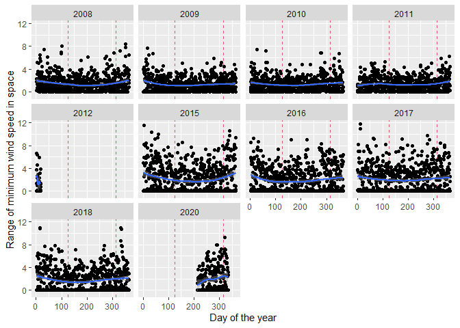<!-- -->

``` r
# range maximum wind speed
summ_space_day_w %>% 
  ggplot(aes(yday, abs(maxws_range))) +
  geom_vline(xintercept = 30*4 + 5, linetype = 2, col = 2) + # May 5
  geom_vline(xintercept = 30*11 - 15, linetype = 2, col = 2) + # Nov 15
  geom_point() +
  geom_smooth() +
  facet_wrap(~year) +
  labs(x = "Day of the year",
       y = "Range of maximum wind speed in space")
```

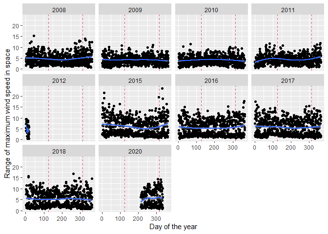<!-- -->

``` r
# range daily wind speed
summ_space_day_w %>% 
  ggplot(aes(yday, abs(rangews))) +
  geom_vline(xintercept = 30*4 + 5, linetype = 2, col = 2) + # May 5
  geom_vline(xintercept = 30*11 - 15, linetype = 2, col = 2) + # Nov 15
  geom_point() +
  geom_smooth() +
  facet_wrap(~year) +
  labs(x = "Day of the year",
       y = "Range of daily wind speeds in space")
```

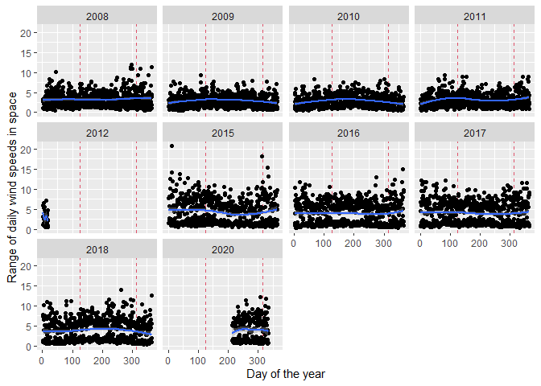<!-- -->

``` r
# range wind speed within a day
summ_within_day_w %>% 
  ggplot(aes(yday, abs(ws_range))) +
  geom_vline(xintercept = 30*4 + 5, linetype = 2, col = 2) + # May 5
  geom_vline(xintercept = 30*11 - 15, linetype = 2, col = 2) + # Nov 15
  geom_point() +
  geom_smooth() +
  facet_wrap(~year) +
  labs(x = "Day of the year",
       y = "Range of wind speeds within a day in a single place")
```

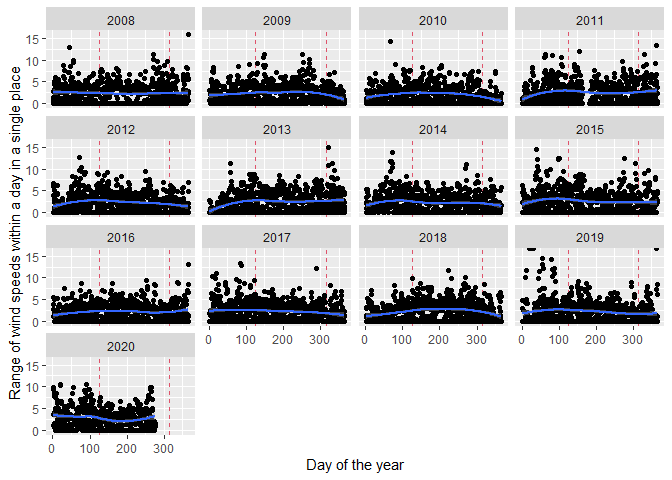<!-- -->

Precipitation
